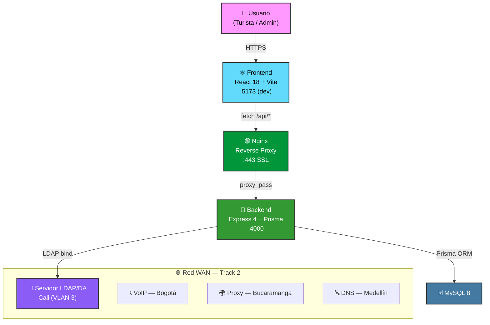

<div align="center">

# 🌊 Turismo Cali — Ruta 7 Ríos

**Plataforma de gestión turística del consorcio "Ruta 7 Ríos" — Santiago de Cali**
**Infraestructura WAN Corporativa · Track 2 · Autenticación LDAP · Auditoría Estricta**

[](https://react.dev/)
[](https://nodejs.org/)
[](https://www.typescriptlang.org/)
[](https://www.prisma.io/)
[](https://www.mysql.com/)
[](https://nginx.org/)
[](https://vite.dev/)
[](LICENSE)

</div>

---

## 📖 Acerca de

**Turismo Cali — Ruta 7 Ríos** es la plataforma web del consorcio turístico que opera dentro de la red WAN corporativa del proyecto integrador (Track 2). Nuestra sede es **Santiago de Cali (VLAN 3)** y proveemos el servicio de **autenticación LDAP/DA** a nivel nacional, además de consumir servicios externos de otras sedes (VoIP, Proxy, DNS).

- 🌐 **Landing Page HTTPS** — Sitio público con servicios turísticos, gestionado con certificados SSL autofirmados (HU-70, HU-79).
- 🔐 **Autenticación Dual** — Login corporativo LDAP/Active Directory + fallback local con bcrypt + JWT.
- 🏗️ **Monorepo Enterprise** — Frontend y Backend en un solo repositorio con npm workspaces.
- 🗄️ **Prisma ORM** — Modelado declarativo, migraciones versionadas, cliente tipado para MySQL 8.
- 🛡️ **Auditoría Estricta** — No repudio con Winston + Morgan + logs en BD (IP, user-agent, timestamp, acción).
- 📡 **Integración WAN** — Consumo de VoIP (Bogotá), Proxy (Bucaramanga) y DNS (Medellín).
- 🔒 **Cumplimiento Legal** — Política de privacidad basada en Ley 1581/2012 y Decreto 1081/2015.

---

## 🏛️ Arquitectura del Sistema



### Servicios WAN — Track 2

| Sede | Servicio | Rol de Cali |
|---|---|---|
| **Cali** | Autenticación LDAP/DA | **Proveedor** |
| **Bogotá** | VoIP (Telefonía IP) | Consumidor |
| **Bucaramanga** | Proxy (Salida a Internet) | Consumidor |
| **Medellín** | DNS | Consumidor |

---

## 🗂️ Estructura del Proyecto

```
Turismo-Cali-UPB/
├── frontend/                        # ⚛️ Frontend — React 18 + Vite + TypeScript + TailwindCSS
│   ├── src/                         # Código fuente del SPA
│   ├── public/                      # Archivos estáticos públicos
│   ├── vite.config.ts               # Configuración de Vite
│   └── package.json
│
├── backend/                         # 🔧 Backend — Express 4 + TypeScript + Prisma ORM
│   ├── src/                         # Código fuente del servidor
│   ├── prisma/                      # Schema, migraciones y seeds
│   └── package.json
│
├── infraestructura/                 # 🏗️ Infraestructura
│   ├── nginx.conf                   # Reverse proxy + HTTPS (HU-70, HU-79)
│   └── backup_db.sh                 # Backup de BD + configs críticas (HU-71)
│
├── docs/                            # 📖 Documentación
│   ├── architecture/                # Diseño del sistema y decisiones técnicas
│   ├── legal/                       # Política de privacidad (Ley 1581/2012)
│   ├── network/                     # Guías de servicios WAN externos
│   └── infrastructure/              # Guía de despliegue local
│
├── .github/                         # CI/CD y gobernanza
│   ├── workflows/                   # CI, Deploy, Stale, Labeler, Format-Issue
│   ├── ISSUE_TEMPLATE/              # User Story + Bug Report
│   ├── PULL_REQUEST_TEMPLATE.md     # Plantilla de PR
│   ├── dependabot.yml               # Actualización automática de dependencias
│   └── labeler.yml                  # Etiquetas automáticas por carpeta
│
├── CODE_OF_CONDUCT.md               # Código de conducta (Contributor Covenant)
├── CONTRIBUTING.md                  # Guía de contribución
├── SECURITY.md                      # Política de reporte de vulnerabilidades
├── LICENSE                          # Licencia MIT
├── package.json                     # Monorepo workspaces (npm)
└── README.md
```

---

## 🚀 Guía de Inicio Rápido

### Prerrequisitos

- **Node.js** ≥ 18.17.0
- **npm** ≥ 9
- **MySQL** ≥ 8.0
- **Nginx** (solo para producción / pruebas HTTPS)

### Instalación

```bash
# 1. Clonar el repositorio
git clone https://github.com/tu-org/Turismo-Cali-UPB.git
cd Turismo-Cali-UPB

# 2. Instalar dependencias (monorepo — instala frontend + backend)
npm install

# 3. Configurar variables de entorno del backend
cp backend/.env.example backend/.env
# Edita backend/.env con tus credenciales de MySQL, JWT, LDAP

# 4. Generar el cliente Prisma (tipado automático)
cd backend && npx prisma generate && cd ..

# 5. Ejecutar migraciones de base de datos
cd backend && npx prisma migrate dev --name init && cd ..
```

### Desarrollo

```bash
# Levantar backend + frontend simultáneamente
npm run dev

# O por separado:
npm run dev:backend    # Express  → http://localhost:4000
npm run dev:frontend   # Vite     → http://localhost:5173
```

| Servicio | URL | Descripción |
|---|---|---|
| Frontend | `http://localhost:5173` | Aplicación React (Vite HMR) |
| Backend API | `http://localhost:4000/api` | REST API Express |
| Health Check | `http://localhost:4000/api/health` | Estado del servidor |
| Prisma Studio | `http://localhost:5555` | `npx prisma studio` |

### Base de Datos

```bash
cd backend

# Generar cliente Prisma
npx prisma generate

# Ejecutar migraciones
npx prisma migrate dev --name init

# Abrir Prisma Studio (interfaz visual de BD)
npx prisma studio
```

---

## 🗺️ Mapa de Rutas

### Frontend — Páginas

| Ruta | Descripción | Acceso |
|---|---|---|
| `/` | Landing page pública (servicios turísticos) | Público |
| `/login` | Inicio de sesión (LDAP / local) | Público |
| `/admin` | Dashboard de administración | Protegido (Admin) |

### Backend — API Endpoints

| Método | Ruta | Descripción | Auth |
|---|---|---|---|
| POST | `/api/auth/login` | Iniciar sesión (LDAP + fallback local) | No |
| GET | `/api/auth/me` | Datos del usuario autenticado | JWT |
| GET | `/api/tourism/services` | Listar servicios turísticos | No |
| GET | `/api/tourism/services/:id` | Detalle de un servicio | No |
| POST | `/api/tourism/services` | Crear servicio turístico | Admin |
| PUT | `/api/tourism/services/:id` | Actualizar servicio | Admin |
| DELETE | `/api/tourism/services/:id` | Eliminar servicio (soft-delete) | Admin |
| POST | `/api/contact` | Enviar mensaje de contacto | No |
| GET | `/api/contact` | Listar mensajes de contacto | Admin |
| PATCH | `/api/contact/:id/read` | Marcar mensaje como leído | Admin |
| GET | `/api/admin/stats` | Estadísticas del sistema | Admin |
| GET | `/api/admin/audit-logs` | Logs de auditoría (no repudio) | Admin |
| GET | `/api/admin/users` | Listar usuarios registrados | Admin |
| GET | `/api/health` | Health check del servidor | No |

---

## 🛠️ Stack Tecnológico

### Frontend

| Herramienta | Propósito |
|---|---|
| ⚛️ **React 18** | Librería de UI con componentes funcionales |
| ⚡ **Vite 5** | Bundler ultrarrápido con HMR |
| 🎨 **Tailwind CSS 3** | Utility-first CSS framework |
| 🔷 **TypeScript 5.3** | Tipado estático |
| 🧭 **React Router 6** | Enrutamiento SPA con rutas protegidas |
| 📡 **Axios** | Cliente HTTP |
| 💎 **Lucide React** | Iconografía SVG moderna |

### Backend

| Herramienta | Propósito |
|---|---|
| 🟢 **Node.js + Express 4** | Runtime y framework HTTP |
| 🔷 **TypeScript 5.3** | Tipado estático |
| 🗄️ **Prisma 5 + MySQL 8** | ORM con migraciones declarativas y cliente tipado |
| 🔑 **JWT (jsonwebtoken)** | Autenticación stateless |
| 🔐 **bcryptjs** | Hashing seguro de contraseñas |
| 🏛️ **ldapjs** | Autenticación corporativa LDAP/Active Directory |
| 🛡️ **Helmet + CORS** | Headers de seguridad HTTP |
| ⏱️ **express-rate-limit** | Rate limiting por endpoint |
| 📝 **Winston + Morgan** | Logging estructurado + auditoría |
| 🗜️ **compression** | Compresión de respuestas HTTP |

### Infraestructura

| Herramienta | Propósito |
|---|---|
| 🌐 **Nginx** | Reverse proxy, terminación SSL, servir estáticos |
| 🔒 **OpenSSL** | Certificados SSL autofirmados |
| 💾 **Bash scripts** | Backup de BD + configuraciones críticas |
| 🔄 **GitHub Actions** | CI/CD (5 workflows) |
| 🤖 **Dependabot** | Actualización automática de dependencias |

---

## 📚 Índice Documental

> Toda la documentación se organiza en [`docs/`](./docs/).

| Categoría | Descripción | Ubicación |
|---|---|---|
| 🏗️ **Arquitectura** | Diseño del sistema, diagramas Mermaid, integración LDAP + Prisma | [`docs/architecture/`](./docs/architecture/) |
| 📜 **Legal** | Política de privacidad (Ley 1581/2012, Decreto 1081/2015) | [`docs/legal/`](./docs/legal/) |
| 🌐 **Red WAN** | Guía de consumo de servicios externos (VoIP, Proxy, DNS) | [`docs/network/`](./docs/network/) |
| 🖥️ **Infraestructura** | Guía de despliegue local (HTTPS, Nginx, certificados) | [`docs/infrastructure/`](./docs/infrastructure/) |
| 📡 **Track 2** | Topología WAN, requerimientos de red, configuración de Cali | [`docs/track 2/`](./docs/track%202/) |

---

## 🏗️ Infraestructura

### Nginx — HTTPS + Reverse Proxy

```bash
# Copiar configuración al servidor
sudo cp infraestructura/nginx.conf /etc/nginx/sites-available/turismocali
sudo ln -s /etc/nginx/sites-available/turismocali /etc/nginx/sites-enabled/
sudo nginx -t && sudo systemctl reload nginx
```

### Backup de BD + Configuraciones Críticas

```bash
# Dar permisos de ejecución
chmod +x infraestructura/backup_db.sh

# Ejecutar backup manual (BD + Nginx + configs del proyecto)
DB_PASSWORD="tu_password" ./infraestructura/backup_db.sh

# Configurar cron (backup diario a las 2:00 AM)
# 0 2 * * * DB_PASSWORD="tu_password" /ruta/al/infraestructura/backup_db.sh >> /var/log/backup_db.log 2>&1
```

---

## 🔐 Autenticación LDAP

El sistema implementa **autenticación dual** como servicio principal de la sede Cali:

1. **LDAP/Active Directory** — Intenta autenticar contra el servidor LDAP corporativo de la red WAN.
2. **Fallback local** — Si LDAP no está disponible, utiliza bcrypt contra la BD local.
3. **Modo desarrollo** — Mock LDAP integrado para probar sin servidor real.

Toda acción autenticada queda registrada en el sistema de auditoría (no repudio).

---

## 🤝 Contribución

1. Crea un **fork** del repositorio.
2. Crea una rama para tu feature: `git checkout -b feature/hu-XX-descripcion`.
3. Haz commit de tus cambios: `git commit -m "feat: descripción del cambio"`.
4. Sube tu rama: `git push origin feature/hu-XX-descripcion`.
5. Abre un **Pull Request** describiendo tus cambios.

> 📖 Consulta la [Guía de Contribución](./CONTRIBUTING.md) para convenciones de código, commits y flujo de trabajo.
> 📝 Usa la [plantilla de Pull Request](./.github/PULL_REQUEST_TEMPLATE.md) para la estructura esperada.
> 🤝 Lee nuestro [Código de Conducta](./CODE_OF_CONDUCT.md) antes de participar.

---

## 🔒 Seguridad

Si descubres una vulnerabilidad de seguridad, **NO** abras un issue público. Consulta nuestra [Política de Seguridad](./SECURITY.md) para el proceso de reporte responsable.

---

## 📄 Licencia

Este proyecto está licenciado bajo la [Licencia MIT](LICENSE) — libre para uso, modificación y distribución.

---

<div align="center">

Hecho con ❤️ por el equipo de desarrollo — **Universidad Pontificia Bolivariana**

<sub>Proyecto Integrador · Infraestructura WAN Corporativa · Track 2 · 2026</sub>

</div>
