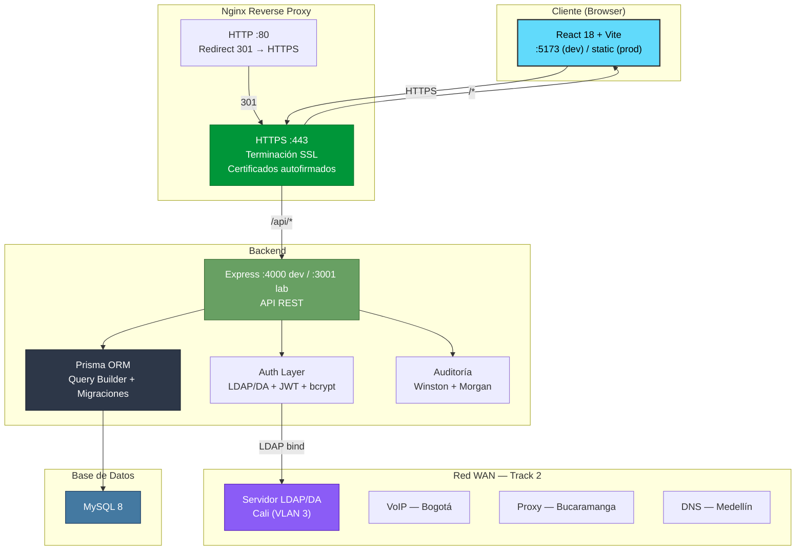
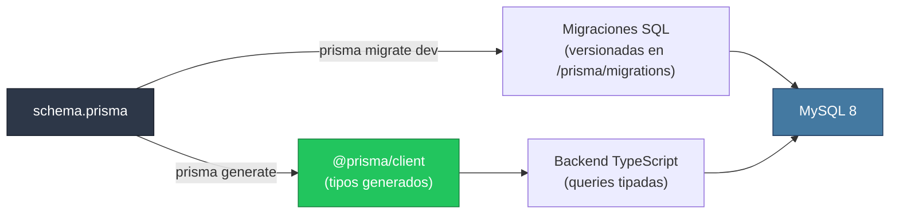
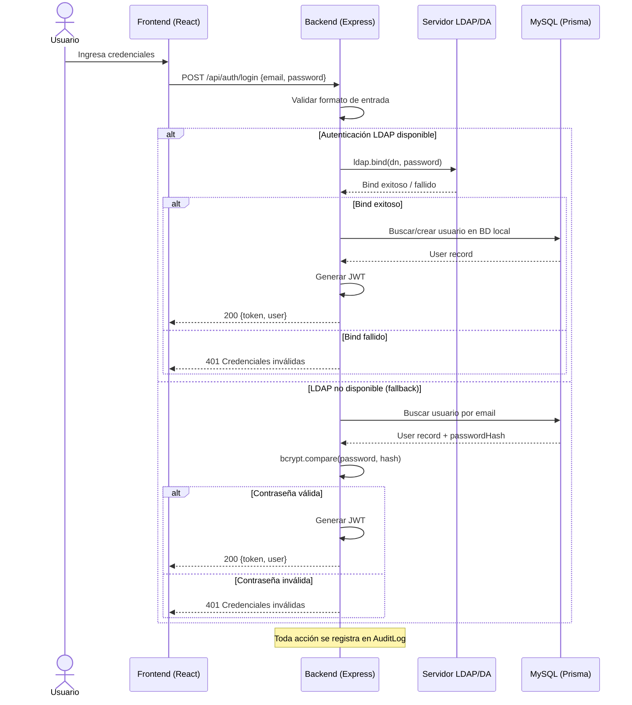
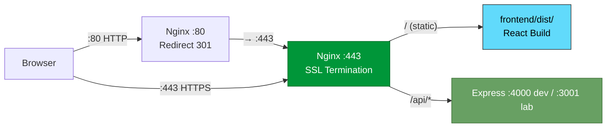
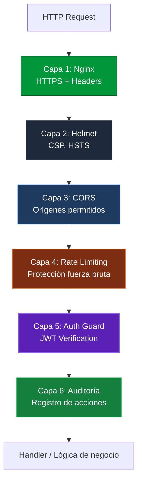

<div align="center">

# 🏛️ Diseño del Sistema / System Design

**Consorcio Turístico "Ruta 7 Ríos" / "Ruta 7 Ríos" Tourism Consortium**
**Infraestructura WAN Corporativa — Track 2 / Corporate WAN Infrastructure — Track 2**

**ES:** Arquitectura del monorepo, integración con servicios de red y decisiones técnicas del despliegue.
**EN:** Monorepo architecture, network-service integration, and deployment design decisions.

</div>

---


---

## 🧭 Guía de Lectura / Reading Guide

| ES | EN |
|---|---|
| El frontend es una SPA React/Vite servida por Nginx en el laboratorio. | The frontend is a React/Vite SPA served by Nginx in the lab. |
| El backend es Express con Prisma, autenticación JWT y conexión a MySQL. | The backend is Express with Prisma, JWT authentication, and MySQL connectivity. |
| La red WAN del Track 2 se documenta como contexto académico e infraestructura de apoyo. | The Track 2 WAN is documented as academic context and supporting infrastructure. |
| La publicación pública debe leerse junto con la auditoría del repositorio. | Public release readiness should be read together with the repository audit. |

---

## 📚 Índice / Table of Contents

1. [Arquitectura General](#1-arquitectura-general)
2. [Estructura del Monorepo](#2-estructura-del-monorepo)
3. [Stack Tecnológico](#3-stack-tecnológico)
4. [Prisma ORM — Capa de Persistencia](#4-prisma-orm--capa-de-persistencia)
5. [Autenticación LDAP/DA](#5-autenticación-ldapda)
6. [Integración con Servicios WAN](#6-integración-con-servicios-wan)
7. [Infraestructura y Despliegue](#7-infraestructura-y-despliegue)
8. [Modelo de Seguridad](#8-modelo-de-seguridad)

---

## 1. Arquitectura General / General Architecture

**ES:** El sistema sigue una arquitectura **cliente-servidor desacoplada** dentro de un monorepo administrado con npm workspaces. El frontend (SPA) se comunica con el backend a través de una API REST. En desarrollo se usa Vite con proxy local; en el laboratorio la publicación se hizo con Nginx, build estático, proxy `/api` y TLS autofirmado documentado en la HU-70.

**EN:** The system follows a **decoupled client-server architecture** inside an npm-workspaces monorepo. The frontend SPA communicates with the backend through a REST API. Development uses the Vite local proxy; the lab deployment used Nginx, a static build, an `/api` reverse proxy, and the self-signed TLS setup documented in HU-70.



### Componentes y Responsabilidades

| Componente | Tecnología | Responsabilidad |
|---|---|---|
| **Frontend SPA** | React 18, Vite, TypeScript, TailwindCSS | Interfaz de usuario, navegación por roles, consumo de API |
| **Backend API** | Express 4, TypeScript | Lógica de negocio, endpoints REST, middlewares de seguridad |
| **ORM** | Prisma 5 | Modelado de datos, migraciones, generación de cliente tipado |
| **Autenticación** | LDAP (ldapjs) + JWT + bcrypt | Autenticación dual corporativa/local |
| **Base de Datos** | MySQL 8 | Persistencia relacional |
| **Reverse Proxy** | Nginx | Terminación SSL, redirección HTTP→HTTPS, proxy a backend |
| **Auditoría** | Winston + Morgan | Logs de no repudio, trazabilidad de acciones |

---

## 2. Estructura del Monorepo

```
Turismo-Cali-UPB/
├── frontend/               # React + TypeScript + TailwindCSS (Vite)
│   ├── src/                # Código fuente del SPA
│   ├── public/             # Archivos estáticos públicos
│   ├── package.json        # Dependencias del frontend
│   └── vite.config.ts      # Configuración de Vite
├── backend/                # Node.js + Express + TypeScript + Prisma
│   ├── src/                # Código fuente del servidor
│   ├── prisma/             # Schema, migraciones y seeds
│   ├── package.json        # Dependencias del backend
│   └── tsconfig.json       # Configuración TypeScript
├── infraestructura/        # Configuración de infraestructura
│   ├── nginx.conf          # Reverse proxy + HTTPS
│   └── backup_db.sh        # Script de respaldo de BD y configuraciones
├── docs/                   # Documentación del proyecto
│   ├── architecture/       # Diseño del sistema y decisiones técnicas
│   ├── infrastructure/     # Despliegue local y laboratorio
│   ├── landing/            # Identidad, UI, SEO, accesibilidad y capturas
│   ├── legal/              # Política de privacidad y cumplimiento
│   ├── network/            # Guías de servicios de red externos
│   └── track-2/            # Evidencias migradas del Track 2
├── .github/                # CI/CD y plantillas de Issues
│   ├── workflows/          # Pipelines de GitHub Actions
│   └── ISSUE_TEMPLATE/     # Plantillas para User Stories y Bug Reports
└── package.json            # Monorepo root (npm workspaces)
```

### Gestión de Workspaces

El monorepo utiliza **npm workspaces** nativo (Node.js ≥ 18):

```json
{
  "workspaces": ["frontend", "backend"]
}
```

Esto permite:
- Instalación unificada de dependencias desde la raíz (`npm install`).
- Ejecución selectiva de scripts: `npm run dev --workspace=frontend`.
- Ejecución paralela: `concurrently` para levantar ambos servicios simultáneamente.

---

## 3. Stack Tecnológico

| Capa | Tecnologías | Versión |
|---|---|---|
| **Frontend** | React, TypeScript, TailwindCSS, Vite, Axios, Lucide React, React Router | 18.x, 5.x, 3.x, 5.x |
| **Backend** | Express, TypeScript, Prisma ORM, Winston, Morgan | 4.x, 5.x, 5.x, 3.x |
| **Base de Datos** | MySQL | 8.x |
| **Autenticación** | ldapjs, jsonwebtoken, bcryptjs | 3.x, 9.x, 2.x |
| **Seguridad** | Helmet, CORS, express-rate-limit | 7.x, 2.x, 7.x |
| **Infraestructura** | Nginx, Bash | — |
| **CI/CD** | GitHub Actions | — |

---

## 4. Prisma ORM — Capa de Persistencia

### 4.1. ¿Por qué Prisma?

Prisma fue seleccionado como ORM por las siguientes razones:

1. **Type-safety completo**: El cliente generado (`@prisma/client`) produce tipos TypeScript a partir del schema, eliminando errores de tipado en queries.
2. **Migraciones declarativas**: El schema `prisma/schema.prisma` define el modelo de datos en un solo lugar; `prisma migrate dev` genera y aplica migraciones SQL automáticamente.
3. **Prisma Studio**: Herramienta visual para inspeccionar y editar datos en desarrollo.
4. **Compatibilidad MySQL**: Soporte nativo para MySQL 8 con todas las funcionalidades del motor.

### 4.2. Flujo de Trabajo



### 4.3. Ejemplo de Schema

```prisma
datasource db {
  provider = "mysql"
  url      = env("DATABASE_URL")
}

generator client {
  provider = "prisma-client-js"
}

model User {
  id            String   @id @default(uuid())
  email         String   @unique
  firstName     String   @map("first_name")
  lastName      String   @map("last_name")
  passwordHash  String   @map("password_hash")
  role          Role     @default(USER)
  isActive      Boolean  @default(true) @map("is_active")
  createdAt     DateTime @default(now()) @map("created_at")
  updatedAt     DateTime @updatedAt @map("updated_at")

  auditLogs     AuditLog[]
  @@map("users")
}

enum Role {
  USER
  ADMIN
}
```

### 4.4. Convenciones

- **Naming**: camelCase en TypeScript, snake_case en la BD (via `@map`).
- **IDs**: UUID v4 generados por Prisma.
- **Soft-delete**: Campo `deletedAt` nullable para registros que admitan eliminación lógica.
- **Timestamps**: `createdAt` y `updatedAt` automáticos en todos los modelos.

---

## 5. Autenticación LDAP/DA

### 5.1. Servicio Principal — Track 2

La sede de **Cali** es responsable de proveer el servicio de **autenticación LDAP/DA** a nivel nacional dentro de la red WAN corporativa. Este es el servicio principal que nuestra sede ofrece al consorcio "Ruta 7 Ríos".

### 5.2. Flujo de Autenticación



### 5.3. Configuración LDAP

El servidor LDAP se configura mediante variables de entorno en el backend:

```env
LDAP_URL=ldap://ldap.cali.ruta7rios.local:389
LDAP_BIND_DN=cn=admin,dc=ruta7rios,dc=local
LDAP_BIND_PASSWORD=<secret>
LDAP_SEARCH_BASE=ou=users,dc=ruta7rios,dc=local
LDAP_SEARCH_FILTER=(uid={{username}})
```

### 5.4. Estrategia de Fallback

| Escenario | Comportamiento |
|---|---|
| LDAP disponible | Autenticación directa contra Active Directory |
| LDAP caído | Fallback a bcrypt contra BD local |
| Modo desarrollo | Mock LDAP para pruebas sin servidor real |

---

## 6. Integración con Servicios WAN

Dentro del Track 2 de conectividad WAN nacional, cada sede del consorcio "Ruta 7 Ríos" provee un servicio específico:

| Sede | Servicio Provisto | Rol de Cali |
|---|---|---|
| **Cali** | Autenticación LDAP/DA | **Proveedor** |
| **Bogotá** | VoIP (Telefonía IP) | Consumidor/Cliente |
| **Bucaramanga** | Proxy (Salida a Internet) | Consumidor/Cliente |
| **Medellín** | DNS | Consumidor/Cliente |

### 6.1. Consumo de VoIP (Bogotá)

Los usuarios de la sede Cali pueden conectarse al servicio VoIP provisto por Bogotá usando softphones como Zoiper o MicroSIP. La configuración apunta al servidor SIP de la red WAN.

### 6.2. Consumo de Proxy (Bucaramanga)

La navegación web corporativa puede enrutarse a través del proxy de la sede Bucaramanga para control de contenido y seguridad.

### 6.3. Consumo de DNS (Medellín)

La resolución de nombres internos del consorcio se delega al servidor DNS provisto por Medellín.

> **Nota**: La documentación detallada de configuración cliente para cada servicio externo se encuentra en `docs/network/external-services-client-guide.md`.

---

## 7. Infraestructura y Despliegue

### 7.1. Nginx — Reverse Proxy + HTTPS



- **Puerto 80**: Redirección permanente (301) a HTTPS.
- **Puerto 443**: Terminación SSL con certificados autofirmados en laboratorio (`/etc/nginx/ssl/ruta7rios.crt`).
- **`/`**: Sirve archivos estáticos del build de React (Vite).
- **`/api/`**: Reverse proxy hacia Express (`localhost:4000` en desarrollo; `127.0.0.1:3001` en la VM de laboratorio).

### 7.2. Backups

El script `infraestructura/backup_db.sh` realiza:
1. Dump de la base de datos MySQL con `mysqldump`.
2. Compresión de configuraciones críticas (`/etc/nginx/`, carpeta del proyecto).
3. Rotación automática de backups antiguos (retención configurable).

### 7.3. CI/CD

Pipeline de GitHub Actions (`.github/workflows/ci.yml`) ejecutado en PRs hacia `develop` y `main`:
- Instalación de dependencias del monorepo.
- Verificación de tipos TypeScript (frontend y backend).
- Linting.
- Build de producción.

---

## 8. Modelo de Seguridad

### Pipeline de Seguridad — Defense in Depth



| Capa | Componente | Protección |
|---|---|---|
| 1 | Nginx | HTTPS obligatorio, headers de seguridad (X-Frame-Options, HSTS) |
| 2 | Helmet | Content Security Policy, X-Content-Type-Options |
| 3 | CORS | Restricción de orígenes permitidos |
| 4 | Rate Limiting | Límite de peticiones por IP (auth: 10/15min) |
| 5 | Auth Guard | Verificación de token JWT + registro en audit log |
| 6 | Auditoría | No repudio — Winston + BD (IP, user-agent, timestamp, acción) |

### Cumplimiento Normativo

- **Ley 1581 de 2012**: Protección de datos personales (ver `docs/legal/politica-privacidad.md`).
- **No repudio**: Todas las acciones autenticadas se registran con IP, timestamp y user-agent.
- **Backups**: Respaldo automatizado de BD y configuraciones críticas.

---

<div align="center">

<sub>Volver al <a href="../../README.md">README principal</a> · <a href="../legal/politica-privacidad.md">Política de Privacidad</a> · <a href="../network/external-services-client-guide.md">Guía de Servicios Externos</a></sub>

</div>
