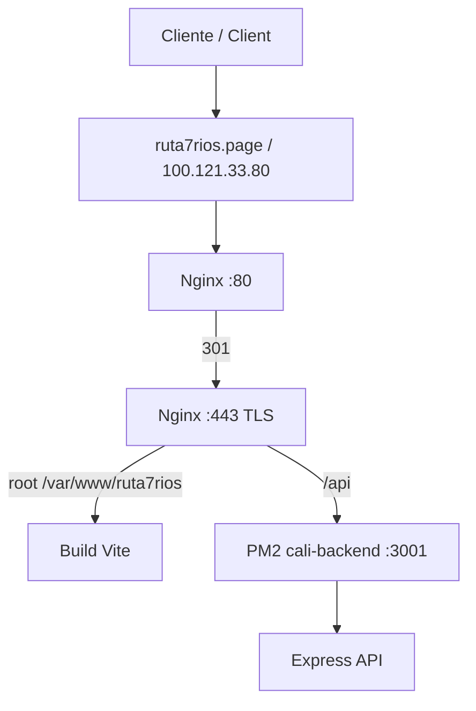

# 🛰️ Despliegue de Laboratorio / Lab Deployment

> **ES:** Evidencia consolidada del despliegue real de Ruta 7 Ríos.
> **EN:** Consolidated evidence for the real Ruta 7 Ríos lab deployment.

---

## 🧭 Estado final / Final state

| Elemento / Item | Valor / Value |
|---|---|
| Dominio / Domain | `ruta7rios.page` |
| Dominio alterno / Alternate domain | `www.ruta7rios.page` |
| IP privada / Private IP | `100.121.33.80` vía Tailscale |
| Servidor web / Web server | Nginx `1.26.3` |
| Directorio publicado / Public directory | `/var/www/ruta7rios` |
| Backend | `cali-backend` con PM2 |
| Puerto backend / Backend port | `127.0.0.1:3001` |
| Configuración / Configuration | `/etc/nginx/conf.d/cali.conf` |
| TLS | Certificado autofirmado / self-signed certificate |

---

## ⚠️ Nota sobre `thisisunsafe` / `thisisunsafe` note

**ES:** En Chrome se usó `thisisunsafe` para continuar ante el bloqueo de un certificado autofirmado en el dominio `.page`. Esto fue una salida de laboratorio por Tailscale y HSTS, no una práctica segura de producción.

**EN:** Chrome's `thisisunsafe` bypass was used to continue past a self-signed certificate warning on the `.page` domain. This was a lab workaround involving Tailscale and HSTS, not a safe production practice.

---

## 🧱 Arquitectura / Architecture



---

## ⚙️ Nginx base

```nginx
server {
    listen 80;
    listen [::]:80;
    server_name ruta7rios.page www.ruta7rios.page;
    return 301 https://$host$request_uri;
}

server {
    listen 443 ssl;
    listen [::]:443 ssl;
    http2 on;
    server_name ruta7rios.page www.ruta7rios.page;

    ssl_certificate     /etc/nginx/ssl/ruta7rios.crt;
    ssl_certificate_key /etc/nginx/ssl/ruta7rios.key;

    root /var/www/ruta7rios;
    index index.html;

    location /api {
        proxy_pass http://127.0.0.1:3001;
    }

    location / {
        try_files $uri $uri/ /index.html;
    }
}
```

---

## ✅ Validaciones / Validations

| Comando / Command | ES | EN |
|---|---|---|
| `nginx -v` | Confirma versión `1.26.3`. | Confirms version `1.26.3`. |
| `sudo nginx -t` | Valida sintaxis. | Validates syntax. |
| `systemctl status nginx` | Confirma servicio activo. | Confirms active service. |
| `ss -tlnp` | Muestra puertos `80` y `443`. | Shows ports `80` and `443`. |
| `curl -kI https://ruta7rios.page/` | Frontend responde `HTTP/2 200`. | Frontend returns `HTTP/2 200`. |
| `curl -I http://ruta7rios.page/` | Redirección `301` a HTTPS. | `301` redirect to HTTPS. |
| `curl -k https://ruta7rios.page/api/health` | API responde `status: ok`. | API returns `status: ok`. |
| `pm2 list` | Backend `cali-backend` online. | `cali-backend` online. |

---

## 📎 Evidencias originales / Original evidence

| HU | Documento / Document |
|---|---|
| HU-70 | [HTTPS/TLS](../track-2/HTTPS/HU-70_HTTPS_TLS.md) |
| HU-78 | [Despliegue Landing](../track-2/HTTPS/HU-78_Despliegue_Landing.md) |
| HU-79 | [Configuración Servidor Web](../track-2/HTTPS/HU-79_Configuracion_Servidor_Web.md) |
| HU-80 | [Evidencias y Manual](../track-2/HTTPS/HU-80_Evidencias_y_Manual.md) |
| Manual | [Manual_Despliegue_Landing.docx](../track-2/HTTPS/Manual_Despliegue_Landing.docx) |

---

## 🛡️ Antes de producción / Before production

| Riesgo / Risk | Acción recomendada / Recommended action |
|---|---|
| Certificado autofirmado / Self-signed certificate | Usar Let's Encrypt, Cloudflare o CA institucional. |
| `thisisunsafe` | Eliminar del flujo operativo. |
| Dominio `.page` con HSTS | Usar certificado confiable antes de exposición pública. |
| Imágenes grandes / Large images | Mantener optimizer y evaluar WebP/AVIF. |
