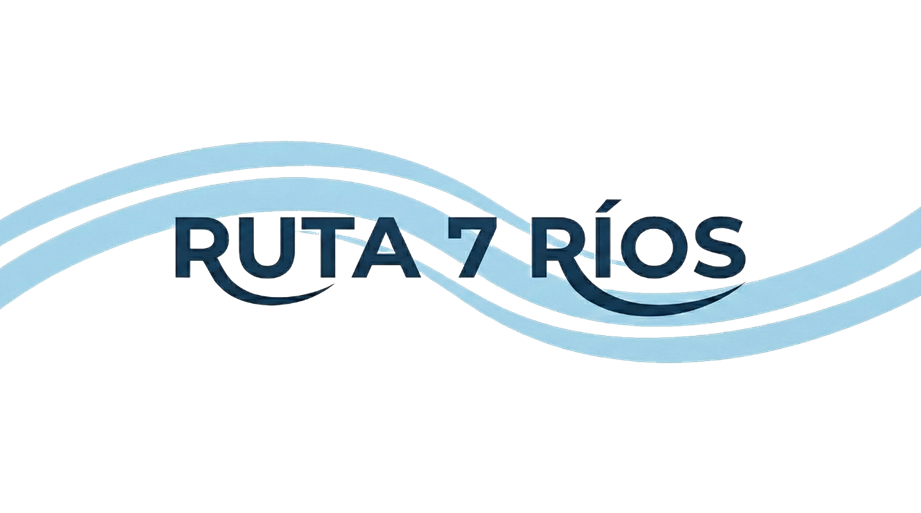
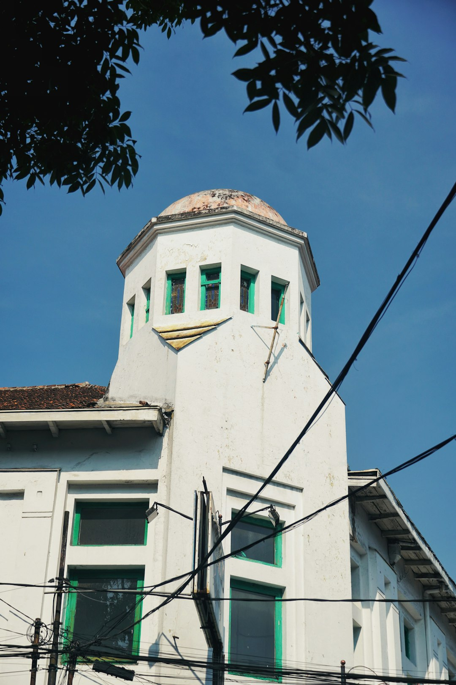
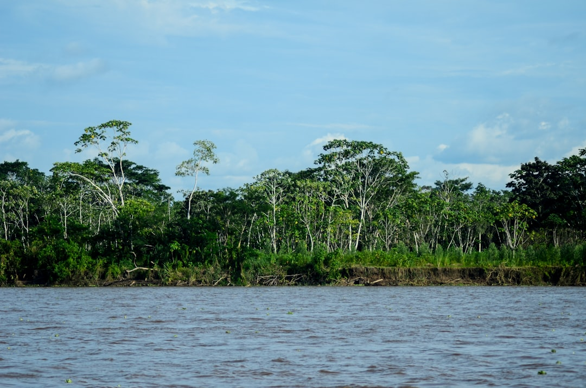
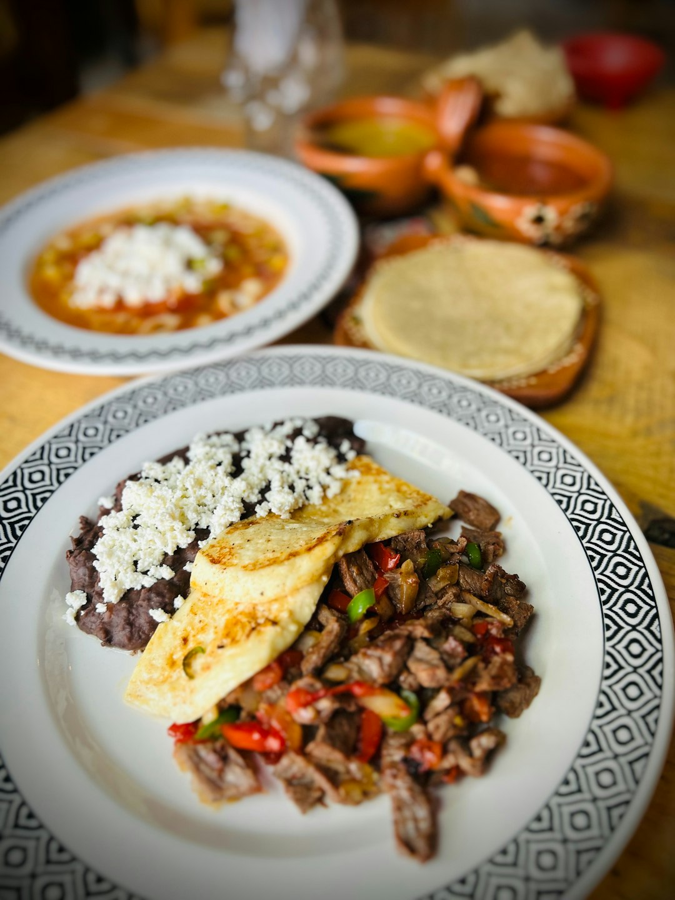
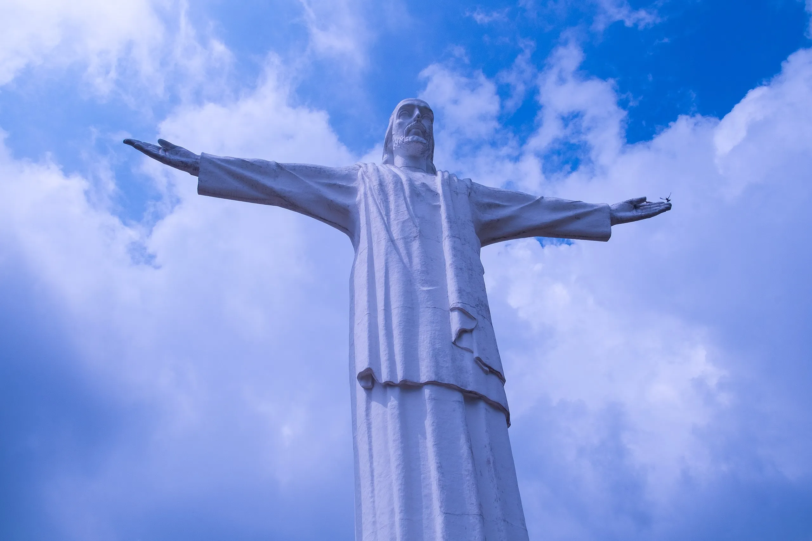
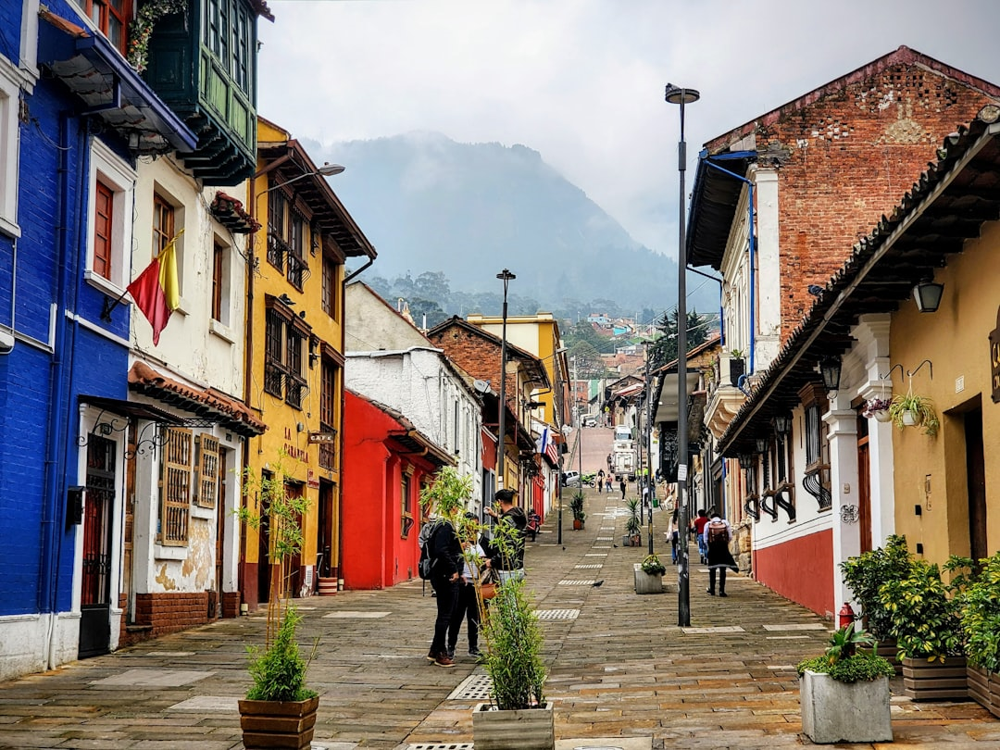
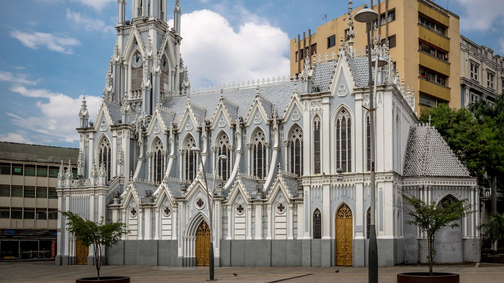

# 🎨 Landing Page - Ruta 7 Ríos

> **ES:** Guía visual, contenido, evidencias y decisiones de la landing.
> **EN:** Visual guide, content, evidence, and landing-page decisions.

---

## 🌊 Identidad / Identity

| Elemento / Item | ES | EN |
|---|---|---|
| Marca / Brand | Ruta 7 Ríos | Ruta 7 Ríos |
| Slogan | "Salsa, sabor y tradición en un solo latido" | "Salsa, flavor, and tradition in one heartbeat" |
| Propósito / Purpose | Promover la oferta turística de Santiago de Cali. | Promote Santiago de Cali's tourism offering. |
| Diferencial / Differentiator | Turismo sostenible, salsa, biodiversidad y experiencias auténticas. | Sustainable tourism, salsa, biodiversity, and authentic experiences. |
| CTA principal / Primary CTA | Explorar Experiencias | Explore Experiences |

---

## 🧩 Historias cubiertas / Covered user stories

| HU | ES | EN |
|---|---|---|
| HU-73 | Contenido y estructura. | Content and structure. |
| HU-75 | Tokens visuales y componentes. | Visual tokens and components. |
| HU-76 | Implementación UI de landing y login. | Landing and login UI implementation. |
| HU-77 | Accesibilidad, SEO y rendimiento. | Accessibility, SEO, and performance. |

---

## 🎛️ Design tokens

| Uso / Use | Nombre / Name | Hex |
|---|---|---|
| Fondo principal / Main background | Blanco Lienzo | `#FFFFFF` |
| Fondo secundario / Secondary background | Beige Arena | `#FFF1DA` |
| Texto principal / Main text | Azul Volcánico | `#181E4B` |
| Texto secundario / Secondary text | Gris Ceniza | `#5E6282` |
| CTA | Naranja Coral | `#DF6951` |

**ES:** La paleta evita negro puro y usa el naranja solo para acciones de conversión.
**EN:** The palette avoids pure black and reserves orange for conversion actions.

---

## 🧱 Componentes / Components

| Sección / Section | Componente / Component | ES | EN |
|---|---|---|---|
| Navbar | `Navbar.tsx` | Navegación responsive. | Responsive navigation. |
| Hero | `Hero.tsx` | Primer impacto visual. | First visual impact. |
| Sobre nosotros | `InfoSection.tsx` | Misión y visión. | Mission and vision. |
| Valores | `ValuesBanner.tsx` | Comunidad, sostenibilidad, autenticidad e innovación. | Community, sustainability, authenticity, and innovation. |
| Experiencias | `ExperiencesSection.tsx` | Líneas turísticas. | Tourism lines. |
| Destinos | `DestinationsSection.tsx` | Lugares destacados. | Featured places. |
| Identidad | `IdentitySection.tsx` | Storytelling cultural. | Cultural storytelling. |
| Contacto | `ContactBanner.tsx` | CTA final. | Final CTA. |
| Footer | `Footer.tsx` | Cierre institucional. | Institutional closing. |
| Login | `LoginPage.tsx` | Acceso administrativo. | Administrative access. |

---

## 🖼️ Galería / Gallery

  
  
  

  
  
  

---

## ♿ SEO, accesibilidad y rendimiento / SEO, accessibility, and performance

| Mejora / Improvement | ES | EN |
|---|---|---|
| Metadata | `title`, `description`, Open Graph y `robots.txt`. | `title`, `description`, Open Graph, and `robots.txt`. |
| Semántica / Semantics | Uso de `nav`, `header`, `main` y etiquetas claras. | Use of `nav`, `header`, `main`, and clear labels. |
| A11y | `alt`, `aria-*`, foco visible y contraste revisado. | `alt`, `aria-*`, visible focus, and contrast review. |
| Performance | `React.lazy`, `Suspense`, lazy images y optimizer. | `React.lazy`, `Suspense`, lazy images, and optimizer. |

---

## 📊 Lighthouse histórico / Historical Lighthouse

| Categoría / Category | Score reportado / Reported score |
|---|---|
| Performance | 73 |
| Accessibility | 94 |
| Best Practices | 100 |
| SEO | 100 |

**ES:** Las oportunidades principales fueron optimizar imágenes, revisar JavaScript no usado y ajustar contraste puntual.
**EN:** The main opportunities were image optimization, unused JavaScript review, and a few contrast adjustments.

---

## 📸 Evidencia visual / Visual evidence

| Vista / View | Evidencia / Evidence |
|---|---|
| Desktop |  |
| Mobile |  |
| Login |  |
| Footer |  |

---

## ✅ Checklist de mantenimiento / Maintenance checklist

- **ES:** Mantener solo assets usados por componentes.
  **EN:** Keep only assets referenced by components.
- **ES:** Optimizar nuevas imágenes antes de agregarlas.
  **EN:** Optimize new images before adding them.
- **ES:** Ejecutar `npm run build:frontend` antes de publicar cambios UI.
  **EN:** Run `npm run build:frontend` before publishing UI changes.
- **ES:** Repetir Lighthouse después de cambios grandes.
  **EN:** Re-run Lighthouse after major visual changes.
